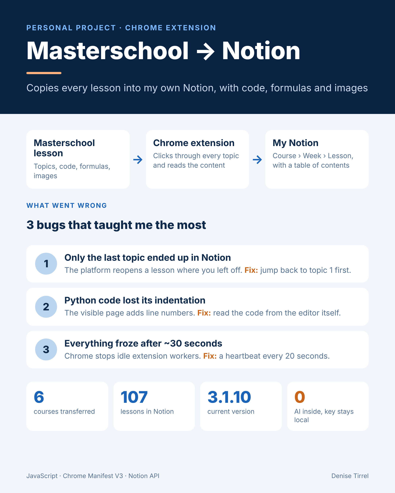

# Masterschool → Notion (Chrome extension)

A personal Chrome extension that copies my Masterschool course lessons into my own Notion workspace, so I can search, annotate and keep them after the course.

> **Note:** This repository documents the project only. The source code is not published, because the extension works with paid course content and is meant for private use with my own account. No course content is stored here.

## What it does

- Opens each lesson and clicks through every topic, starting from topic 1
- Writes one Notion page per lesson, nested as **Course › Week › Lesson**
- Adds a table of contents and turns each topic into a heading
- Keeps code blocks with their indentation, without line numbers
- Converts KaTeX formulas into native Notion equations
- Expands collapsible sections (solutions, hints) and keeps their text
- Uploads images to Notion; if an image can't be loaded, it links it instead
- Skips lessons that already exist, so a second run only adds what's missing
- Adds a "Not transferred" note at the end of a page when something couldn't be copied (e.g. embedded coding exercises)

## How it's built

| Part | Role |
| --- | --- |
| `manifest.json` | Chrome Manifest V3 configuration |
| Service worker (`background.js`) | Runs the transfer job, uploads images, talks to the Notion API |
| Content script (`extract.js`) | Reads topics, code, formulas and images from the lesson page |
| Popup | Choose weeks or a single lesson, start/cancel, live log |
| Options page | Notion integration key and target page, connection test |

Plain JavaScript, no frameworks, no build step, no AI. The Notion key is stored locally in the browser and only sent to `api.notion.com`.

## Three bugs that taught me the most

**1. Only the last topic ended up in Notion.**
The platform reopens a lesson at the topic you visited last. The extension read from there to the end, which was often just one topic.
*Fix:* load the lesson's first topic directly before reading.

**2. Python code lost its indentation.**
The visible page renders code with line numbers and a "Copied code" label, and the indentation didn't survive copying.
*Fix:* read the code from the code editor's own model instead of the rendered HTML.

**3. Everything froze after about 30 seconds, and Cancel stopped working.**
Chrome shuts down an extension's service worker after roughly 30 seconds without extension API activity. Two slow image downloads in a row (each with a 30-second timeout) were enough to kill the job silently.
*Fix:* while a job is running, a small heartbeat calls an extension API every 20 seconds. Cancel now also resets a job that is no longer running.

## Status

Version 3.1.10. Six courses with 107 lessons transferred so far (SQL, Python, Power BI, spreadsheets).

Built by Denise Tirrel in pair-programming sessions with Claude.
